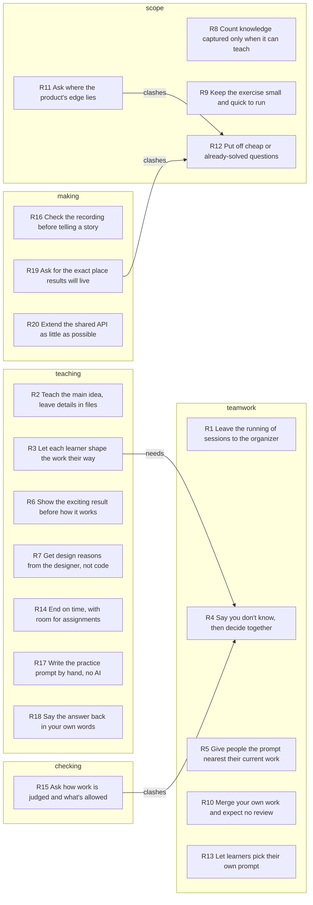

# Unspoken rules

They keep the main idea, each learner's own attempt and a plain admission of not knowing, and give up detail, review and early answers.

## Key

- Rule row: when `when`, `who` holds on to `keeps` and gives up `lets_go`. `for` and `against` list Evidence ids.
- `conf`: how sure the rule is, not how much it matters. Take the highest `how` among its `for` moments: `did` 0.5, `told` 0.4, `judged` 0.3, `would` 0.2. Add 0.1 per `for` moment after the first. Subtract 0.2 if `against` lists any, and 0.1 if the rule is in an `or` link. Lowest 0.1.
- `how`, first that fits: `did` chose, refused, corrected, checked or gave an order in the transcript; `told` described an earlier choice; `judged` called something good, bad or doubtful; `would` said what they want or would do.
- `topic`, first that fits: `teaching` how people learn; `scope` what to take on or leave; `teamwork` how work is shared; `checking` how work is judged; `making` how work is done.
- `link`: `or` both fit the same moments and only one can be true; `clashes` they pull opposite ways in one situation; `needs` the first only makes sense after the second.
- Cells: `-` is empty; ids are split by spaces. Read columns by name. Later schemas may add some.

## Rules

| id | rule | who | when | keeps | lets_go | topic | conf | for | against |
|---|---|---|---|---|---|---|---|---|---|
| R1 | Leave the running of sessions to the organizer | Vinnie | a session needs starting, people chased, or organizing | the teaching itself | calling the start, messaging people, arranging the sessions | teamwork | 0.8 | E1 E2 E33 E43 | - |
| R2 | Teach the main idea, leave details in files | Vinnie | a detail comes up while teaching the group | the main point and the pace | the full detail, even when it is true | teaching | 0.8 | E4 E5 E28 E31 | - |
| R3 | Let each learner shape the work their way | Vinnie | setting class work that has no known best answer | each learner's own choice of content and layout | one set format for everyone | teaching | 0.8 | E10 E17 E34 E40 | - |
| R4 | Say you don't know, then decide together | Vinnie | asked for an answer or a test not yet known | an open admission and a group look at results | a made-up answer or marking rules set early | teamwork | 0.7 | E23 E37 E7 | - |
| R5 | Give people the prompt nearest their current work | Vinnie | handing out prompts when someone already works on one | the match between a person and existing work | a new task for every person | teamwork | 0.7 | E13 E15 E41 | - |
| R6 | Show the exciting result before how it works | Vinnie | opening a lesson or showing newcomers a tool | the listeners' interest | starting with basics or the prompt text | teaching | 0.6 | E3 E14 | - |
| R7 | Get design reasons from the designer, not code | Vinnie | learning why a system is built the way it is | choices the designer says aloud | the code as proof of what was meant | teaching | 0.6 | E8 E29 | - |
| R8 | Count knowledge captured only when it can teach | Vinnie | judging minutes, or where the capture work ends | knowledge passed on to another person | a summary of what was said | scope | 0.6 | E19 E9 | - |
| R9 | Keep the exercise small and quick to run | Vinnie | setting limits for the class exercise | little time spent and a fast-running prompt | polish, the code and other sources | scope | 0.6 | E11 E39 | - |
| R10 | Merge your own work and expect no review | Vinnie | class work is ready to go into the repository | speed, and time not spent on reviews | a check by the teacher before merging | teamwork | 0.6 | E12 E35 | - |
| R11 | Ask where the product's edge lies | Mateo Robles | a product idea has just been explained | a clear line on what the product covers | guessing whether a feature is in or out | scope | 0.6 | E18 E24 | - |
| R12 | Put off cheap or already-solved questions | Vinnie | asked early about folders, hosting or privacy | work on the new, interesting problem | an answer now on everything else | scope | 0.6 | E22 E25 | - |
| R13 | Let learners pick their own prompt | Vinnie | sharing out prompts nobody is already tied to | each learner's own pick | one prompt per person | teamwork | 0.6 | E26 E42 | - |
| R14 | End on time, with room for assignments | Vinnie | the lesson nears its planned length | the end time and minutes for assignments | the rest of the technical talk | teaching | 0.6 | E30 E32 | - |
| R15 | Ask how work is judged and what's allowed | Jason | handed an open exercise | a stated test and stated sources | starting on a guess | checking | 0.6 | E36 E38 | - |
| R16 | Check the recording before telling a story | Vinnie | about to retell a story others will need | one telling, saved in the transcript | repeating it to each person | making | 0.5 | E6 | - |
| R17 | Write the practice prompt by hand, no AI | Vinnie | a learner rewrites a prompt to learn the language | learning from writing it and looking things up | the speed of AI-written work | teaching | 0.5 | E16 | - |
| R18 | Say the answer back in your own words | Mateo Robles | a question has just been answered | a restated answer the speaker can confirm | taking the answer as understood, unchecked | teaching | 0.5 | E20 | - |
| R19 | Ask for the exact place results will live | Jonathan ELBAZ | told results will be stored, with no place named | a place visible in the repository | an answer about file format alone | making | 0.5 | E21 | - |
| R20 | Extend the shared API as little as possible | Vinnie | one model provider needs more than the shared API | a generic API other apps use unchanged | large extensions shaped by one provider | making | 0.5 | E27 | - |

## Map

## Links

| from | link | to | note |
|---|---|---|---|
| R3 | needs | R4 | each tries their own way because nobody knows the best |
| R11 | clashes | R12 | one asks about hosting now, the other puts it off |
| R15 | clashes | R4 | one wants the test first, the other finds it later |
| R19 | clashes | R12 | one wants the folder named, the other adds it later |

## Evidence

| id | at | who | how | quote |
|---|---|---|---|---|
| E1 | 0:41 | Vinnie | did | "Cynthia, let me know when I should start." |
| E2 | 1:39 | Vinnie | did | "I don't, I don't see him ping him. Get that thing. Cynthia, can you ping each person?" |
| E3 | 2:28 | Vinnie | did | "I'm gonna start from The most exciting thing, and I'm gonna work backwards so that to get you all interested." |
| E4 | 7:33 | Vinnie | did | "Where is it? I'm sorry about this. It's probably in here. Well, you can look at it ... But if you look, it's like it's all in there." |
| E5 | 11:29 | Vinnie | did | "Runville is the prompting language, and I'm not gonna bore you with the details, but I'm happy to answer questions" |
| E6 | 13:30 | Vinnie | did | "I think it's worth saying again, and We have it in the transcript, AI notes and transcription on. Good, good. I don't have to repeat it." |
| E7 | 17:03 | Vinnie | judged | "This is a new idea. I'm not gonna pretend that I know what I'm doing. So if you have input, ... of course I'm happy to hear it." |
| E8 | 18:39 | Vinnie | did | "nobody knows them, so no one can tell if the code is doing the right thing. ... so your job is to get it out of me" |
| E9 | 19:46 | Vinnie | judged | "Because this just tells you a summary of the conversation. What we really want is we want a prompt that will extract the knowledge." |
| E10 | 20:09 | Vinnie | did | "Everyone is gonna write their own prompt to process the minutes. And create the design document their way, whatever they think is important" |
| E11 | 20:36 | Vinnie | did | "you'll get it to how you want it as best as you can. Don't waste too much time on it" |
| E12 | 20:59 | Vinnie | did | "Put that in a pull request and merge it. Everyone has to merge their own commits. I don't want to be sitting there having to review anything." |
| E13 | 22:08 | Vinnie | did | "Jason and Glenn are exempt cause you already have it, you're already working on enough prompts." |
| E14 | 23:02 | Vinnie | did | "No, no, no, no, no, I, you misunderstand me. I'm not, I don't wanna look at the prompt, I wanna look at the Reddit page." |
| E15 | 23:09 | Vinnie | did | "obviously Will has meant to graph, because that's pretty much what Toctron is, and then these others are all kind of fairly equal." |
| E16 | 23:45 | Vinnie | did | "it's very important not to use any AI like you have to write it by hand, because if you use AI you're not gonna learn anything." |
| E17 | 24:33 | Vinnie | did | "I'll leave it up to you to figure out like how you want to present it." |
| E18 | 26:06 | Mateo Robles | did | "Like the enterprise to distribute that knowledge more effectively like through software or anything of the sort, or is that kind of out of the scope?" |
| E19 | 26:12 | Vinnie | did | "No, no, that's, that's, so the pipeline starts with the capture and it ends when it's transferred to another person, right?" |
| E20 | 28:06 | Mateo Robles | did | "so like the value will kind of be in that transference from the individual to another individual and not necessarily in any implemented like workflow for the enterprise." |
| E21 | 30:31 | Jonathan ELBAZ | did | "OK, but yes, but where proceed where? Because, I, I'm, I'm, I'm looking at the Rainville classroom repository, and I didn't see any further regarding the, the, the knowledge" |
| E22 | 30:35 | Vinnie | did | "Well, I mean, we'll, we'll add a folder. Don't we adding folders is free, don't worry." |
| E23 | 30:51 | Vinnie | did | "I'm not pretending to have all the answers. What we're doing is an exploration that we're performing together." |
| E24 | 31:34 | Mateo Robles | did | "is that something that you, you would consider kind of maybe like splitting like the service to like a self-hosting and then a service" |
| E25 | 31:52 | Vinnie | did | "I, I don't wanna know about it. I don't want to care about it. I only want us to solve the interesting problem." |
| E26 | 33:35 | Vinnie | did | "Greg, it sounds like you wanna work on the ... Is that the one you want?" |
| E27 | 40:04 | Vinnie | did | "on the gateway side, Andrew, our goal is to Make our endpoint, make our endpoint. Support the generic API and add just enough extensions." |
| E28 | 40:50 | Vinnie | did | "It it would be in this file, you have to look in this file, but" |
| E29 | 40:59 | Vinnie | judged | "this is the tacit knowledge, right? This is, you're not gonna find this by looking in the rust code, that's just gonna overwhelm you." |
| E30 | 41:16 | Vinnie | did | "I want to make sure this doesn't go over an hour, cause that could be too much for everyone." |
| E31 | 42:56 | Vinnie | did | "So yeah, that's part of the messages, but I don't want to overwhelm everyone." |
| E32 | 44:39 | Vinnie | did | "Like, for example, this carries the tool catalog. All right, we're at the 5 minute mark." |
| E33 | 44:58 | Vinnie | did | "So here's what I would like to do for the next session. Cynthia is gonna organize the sessions." |
| E34 | 45:33 | Vinnie | did | "You put the output in your directory, you can organize it however you want." |
| E35 | 45:33 | Vinnie | did | "And then submit a pull request. And then merge it yourself, but don't use the merge it with the command line, don't, don't merge with the GitHub interface." |
| E36 | 45:48 | Jason | did | "What's the evaluation, criteria here? Like, how do we know that we did a good job on this?" |
| E37 | 45:49 | Vinnie | did | "I have no idea. You, we'll look at them together and we'll like comment on like what looks good or what doesn't, and we'll try to figure it out" |
| E38 | 46:30 | Jason | did | "And you want it to be only based on the transcript. It can't look at the code or anything else, right?" |
| E39 | 46:37 | Vinnie | did | "Yeah, just just the transcript is fine. We don't wanna, we don't wanna go into the weeds. We don't wanna have a prompt that takes too long to run." |
| E40 | 46:53 | Vinnie | did | "That's the core problem, and you're all gonna try to solve it your own way." |
| E41 | 47:11 | Vinnie | did | "so I would like also everyone to choose. One of these tools, right? Will gets entograph." |
| E42 | 47:31 | Vinnie | did | "if two people have to grab the same prompt that's OK, just pick the one that you like." |
| E43 | 47:47 | Vinnie | did | "Cynthia will organize the rest." |
