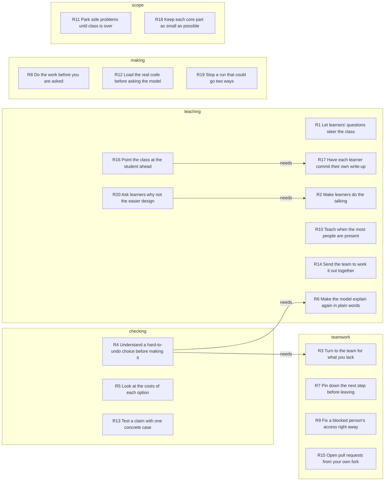

# Unspoken rules

They let learners' questions and voices run the class, and they will not make a hard-to-undo choice until they and the team understand it.

## Key

- Rule row: when `when`, `who` holds on to `keeps` and gives up `lets_go`. `for` and `against` list Evidence ids.
- `conf`: how sure the rule is, not how much it matters. Take the highest `how` among its `for` moments: `did` 0.5, `told` 0.4, `judged` 0.3, `would` 0.2. Add 0.1 per `for` moment after the first. Subtract 0.2 if `against` lists any, and 0.1 if the rule is in an `or` link. Lowest 0.1.
- `how`, first that fits: `did` chose, refused, corrected, checked or gave an order in the transcript; `told` described an earlier choice; `judged` called something good, bad or doubtful; `would` said what they want or would do.
- `topic`, first that fits: `teaching` how people learn; `scope` what to take on or leave; `teamwork` how work is shared; `checking` how work is judged; `making` how work is done.
- `link`: `or` both fit the same moments and only one can be true; `clashes` they pull opposite ways in one situation; `needs` the first only makes sense after the second.
- Cells: `-` is empty; ids are split by spaces. Read columns by name. Later schemas may add some.

## Rules

| id | rule | who | when | keeps | lets_go | topic | conf | for | against |
|---|---|---|---|---|---|---|---|---|---|
| R1 | Let learners' questions steer the class | Vinnie | planning or running a class session | time for the questions people bring | a fixed lesson plan | teaching | 0.8 | E15 E35 E1 E45 | - |
| R2 | Make learners do the talking | Vinnie | there is material to explain or read out | a learner saying it aloud | giving the whole talk alone | teaching | 0.8 | E5 E6 E8 E19 | - |
| R3 | Turn to the team for what you lack | Vinnie | a design question is beyond their own judgment | the team's knowledge, asked for openly | deciding alone or seeming to know | teamwork | 0.8 | E13 E23 E26 E28 | - |
| R4 | Understand a hard-to-undo choice before making it | Vinnie | advice on a costly choice is hard to follow | their own grasp of the reasons | starting the build right away | checking | 0.7 | E27 E14 E21 | - |
| R5 | Look at the costs of each option | Vinnie | choosing between two designs | the drawbacks of both in view | a quick one-sided answer | checking | 0.7 | E18 E20 E31 | - |
| R6 | Make the model explain again in plain words | Vinnie | the model's answer is full of unknown terms | an explanation a beginner can follow | the short answer written for experts | teaching | 0.7 | E33 E22 E34 | - |
| R7 | Pin down the next step before leaving | Cynthia | a plan changes or a meeting is ending | a clear answer on who does what | leaving the next step unsaid | teamwork | 0.7 | E42 E44 E46 | - |
| R8 | Do the work before you are asked | Mateo Robles | a task is set or likely coming | the work already done when asked | waiting to be told or reminded | making | 0.6 | E2 E36 E50 | - |
| R9 | Fix a blocked person's access right away | Vinnie | someone cannot work for lack of access | that person able to work now | waiting for the usual admin | teamwork | 0.6 | E3 E38 | - |
| R10 | Teach when the most people are present | Vinnie | setting when a class starts or meets | everyone in the session together | a prompt start and a fuller schedule | teaching | 0.6 | E4 E41 | - |
| R11 | Park side problems until class is over | Vinnie | a glitch or stray item shows up mid-class | the lesson moving | fixing or reading it right then | scope | 0.6 | E11 E40 | - |
| R12 | Load the real code before asking the model | Vinnie | putting a design question to the model | the model reading the actual code | an answer from general knowledge | making | 0.6 | E16 E17 | - |
| R13 | Test a claim with one concrete case | Vinnie | a teammate offers a shortcut or waves off a worry | a real case that would break it | the general argument | checking | 0.6 | E25 E30 | - |
| R14 | Send the team to work it out together | Vinnie | a hard question is still open after class | the team solving it without the teacher | handing over a ready answer | teaching | 0.6 | E32 E43 | - |
| R15 | Open pull requests from your own fork | Greg | adding work to a shared repo | a main repo with no side branches | the quick push of a branch there | teamwork | 0.6 | E37 E39 | - |
| R16 | Point the class at the student ahead | Vinnie | one learner has done more than asked | open praise and a push to the rest | keeping the praise private | teaching | 0.6 | E51 E52 | - |
| R17 | Have each learner commit their own write-up | Vinnie | class material or a transcript is ready | each person's own output in the repo | one copy made by the teacher | teaching | 0.5 | E10 E47 E49 | E48 |
| R18 | Keep each core part as small as possible | Vinnie | deciding what goes into a core part | the least code that still works | features built into the core | scope | 0.5 | E9 E12 | - |
| R19 | Stop a run that could go two ways | Vinnie | two workers touch the same file at once | every run going exactly the same way | letting safe but unrepeatable work go on | making | 0.5 | E24 E29 | - |
| R20 | Ask learners why not the easier design | Vinnie | a learner describes how a part works | the reason behind the design | a plain account of what it does | teaching | 0.5 | E7 | - |

## Map

## Links

| from | link | to | note |
|---|---|---|---|
| R4 | needs | R3 | the team's explaining is how the choice gets understood |
| R4 | needs | R6 | a plain re-telling lets the pros and cons be judged |
| R16 | needs | R17 | only posted output can be shown to the class |
| R20 | needs | R2 | the why-question follows a learner's own account |

## Evidence

| id | at | who | how | quote |
|---|---|---|---|---|
| E1 | 0:08 | Vinnie | would | "Oh boy, I hope people have questions, cause I do not have a syllabus planned." |
| E2 | 2:09 | Mateo Robles | told | "Yeah, I, I wrote the prompt, but I, I couldn't push it. I didn't have. Right access." |
| E3 | 2:53 | Vinnie | did | "OK, let me, I can add you." |
| E4 | 2:53 | Vinnie | did | "Who's joining? Should I wait? I'll wait 2 minutes." |
| E5 | 4:32 | Vinnie | did | "OK, do you wanna talk about it?" |
| E6 | 9:13 | Vinnie | did | "Actually, Andrew, why don't you tell us how all that works?" |
| E7 | 10:35 | Vinnie | did | "Wouldn't it be easier to just put it in the workshop or to put it in the harness, instead of having it go to a separate. Server." |
| E8 | 12:13 | Vinnie | did | "OK, tell, tell me what you learned." |
| E9 | 13:25 | Vinnie | told | "The engine is designed so that it's it, it's the smallest. It's the smallest amount of like functionality that delivers the Runville prompting language." |
| E10 | 16:50 | Vinnie | did | "Can figure out how to organize that information into a document, and I want to see you like committed to the repo." |
| E11 | 17:08 | Vinnie | did | "I need help with this, man. Like, it's, this is not right. It's. We'll get to that later." |
| E12 | 19:17 | Vinnie | told | "It's not difficult to export the VFS API because like I kept it intentionally small." |
| E13 | 21:16 | Vinnie | did | "It's a decision that we are gonna have to weigh. And I don't wanna make it on my own." |
| E14 | 22:27 | Vinnie | judged | "That's easy to change. ... So this is a consequential decision that needs to be made carefully." |
| E15 | 23:58 | Vinnie | did | "I love this question. ... This is a really good question. And I The best person to answer it is Claude." |
| E16 | 24:27 | Vinnie | did | "So we're gonna say, we're gonna bring in that VFS crate into our context. Just like that." |
| E17 | 25:51 | Vinnie | did | "So context, we're bringing the virtual file system rate into the context." |
| E18 | 26:09 | Vinnie | did | "Should the members of access be synchronous or asynchronous. Discuss the pros and cons of each." |
| E19 | 28:28 | Vinnie | did | "OK, here, read that out loud." |
| E20 | 28:56 | Vinnie | did | "Synchronous members, a lot of pros, but look at the cons, blocking." |
| E21 | 29:22 | Vinnie | judged | "It's kind of hard for me to make heads or tails of all this. ... I really don't quite understand all of it" |
| E22 | 30:22 | Vinnie | judged | "the AI's will say things, and it's really like jargon dense, and it assumes like that I have a context where I can understand everything that it's saying." |
| E23 | 30:54 | Vinnie | did | "Like, how am I supposed to evaluate this when I don't know what those things are? Any, does anyone have any idea about those things?" |
| E24 | 32:24 | Vinnie | told | "Every run has to be completely deterministic. It has to run the same exact way, no matter how the harness decides to do the concurrency." |
| E25 | 33:37 | Vinnie | did | "let's say you have a research agent and you're doing a fan out, ... You gotta make sure that they're all collecting into little separate virtual files" |
| E26 | 35:03 | Vinnie | did | "Does that make any sense to you, Andrew?" |
| E27 | 36:34 | Vinnie | did | "But the problem is, I'm not comfortable with it yet because I can't understand this blibber blabber over here" |
| E28 | 37:07 | Vinnie | would | "That's where you all come in. Maybe I would like you all to explain it to me." |
| E29 | 39:13 | Vinnie | told | "two different prompts, they they can butt heads if they try to access the same file. We make it stop." |
| E30 | 42:14 | Vinnie | did | "What if you're compressing, what if you're compressing like a 1 gigabyte file?" |
| E31 | 43:00 | Vinnie | judged | "However, that said, like, but there's costs of going async." |
| E32 | 43:46 | Vinnie | did | "I would like you guys to have your own little meeting and do what I did. Do these prompts." |
| E33 | 44:06 | Vinnie | did | "So explain it again for someone who is just now learning how the VFS works." |
| E34 | 46:13 | Vinnie | judged | "So access is a key card. Hey, that's kind of cool." |
| E35 | 46:59 | Vinnie | did | "Well, I don't want to waste your time, but Do you have any questions for me? What do you want to do tomorrow?" |
| E36 | 47:39 | Mateo Robles | told | "Oh sorry, I was gonna say I have access now, so mine was just merged." |
| E37 | 47:48 | Greg | did | "You should create a fork of the repo, and then open your PRs from your fork so that we're not creating topical branches in in the main repo." |
| E38 | 48:34 | Vinnie | did | "Oh yeah, you're on maintain my bad. ... OK, you're an admin now." |
| E39 | 48:50 | Greg | judged | "I think we've all made a branch when we shouldn't have. So, you gotta do it at least once." |
| E40 | 49:03 | Vinnie | judged | "Oh, dude, look at this. Man, this prompt is shouting. Distraction, OK." |
| E41 | 49:22 | Vinnie | would | "we should try to just meet once a day ... I think it's better for everyone to be in it. Cause I can reach more people at once." |
| E42 | 49:43 | Cynthia | did | "we'll meet with you once a day, but we'll also still have the huddle for the team to" |
| E43 | 49:57 | Vinnie | judged | "I think the team meeting without me, and just being able to, like, strategize together and learn to problem solve together is a very good idea." |
| E44 | 50:35 | Cynthia | did | "So what do you want folks to do, ... so I guess I'll ask you at the end of Monday's meeting, what you want folks to accomplish" |
| E45 | 51:31 | Vinnie | would | "Come to class and ask questions, take notes. It's it's, it's the same thing." |
| E46 | 51:36 | Cynthia | did | "OK. All right. Are you gonna put the transcript up?" |
| E47 | 51:43 | Vinnie | did | "I'll do mine, but I want everyone to do theirs." |
| E48 | 51:51 | Vinnie | did | "You don't have to if you don't want to." |
| E49 | 52:07 | Vinnie | did | "I want you to run that extraction prompt on the transcript, and then put the output in your student folder." |
| E50 | 52:25 | Mateo Robles | told | "I already read it on the last, the last huddle did, should I, I, I don't, I don't think I pushed it, but" |
| E51 | 52:37 | Vinnie | did | "Wow! Oh, I like yours, it's really tight. This is interesting. You guys should look at this." |
| E52 | 53:02 | Vinnie | did | "Guys, Matteo's ahead of you. Don't let him get away." |
