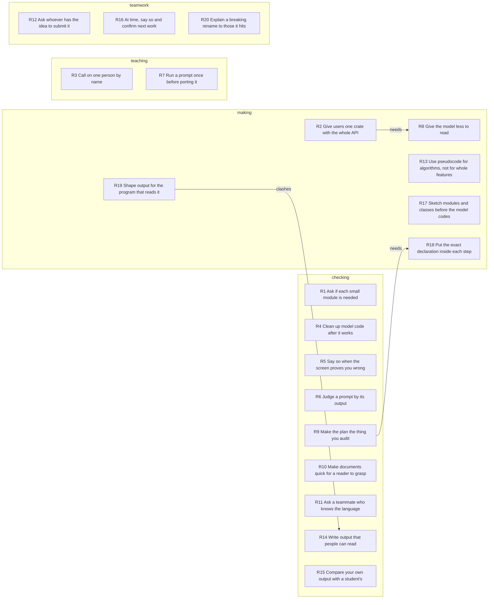

# Unspoken rules

They trust what they can see on screen, such as output that ran and code a person can read, and they ask whether each piece is needed.

## Key

- Rule row: when `when`, `who` holds on to `keeps` and gives up `lets_go`. `for` and `against` list Evidence ids.
- `conf`: how sure the rule is, not how much it matters. Take the highest `how` among its `for` moments: `did` 0.5, `told` 0.4, `judged` 0.3, `would` 0.2. Add 0.1 per `for` moment after the first. Subtract 0.2 if `against` lists any, and 0.1 if the rule is in an `or` link. Lowest 0.1.
- `how`, first that fits: `did` chose, refused, corrected, checked or gave an order in the transcript; `told` described an earlier choice; `judged` called something good, bad or doubtful; `would` said what they want or would do.
- `topic`, first that fits: `teaching` how people learn; `scope` what to take on or leave; `teamwork` how work is shared; `checking` how work is judged; `making` how work is done.
- `link`: `or` both fit the same moments and only one can be true; `clashes` they pull opposite ways in one situation; `needs` the first only makes sense after the second.
- Cells: `-` is empty; ids are split by spaces. Read columns by name. Later schemas may add some.

## Rules

| id | rule | who | when | keeps | lets_go | topic | conf | for | against |
|---|---|---|---|---|---|---|---|---|---|
| R1 | Ask if each small module is needed | Vinnie | an outline shows a module or type holding very little | asking, of the model too, whether the code needs it | code kept only because the model wrote it | checking | 0.9 | E20 E1 E18 E21 E22 | - |
| R2 | Give users one crate with the whole API | Vinnie | other people start building programs on the library | one flat crate that holds all a user needs | the old crate names | making | 0.8 | E3 E7 E10 E12 E14 | - |
| R3 | Call on one person by name | Vinnie | he wants the class's view on work shown on screen | an answer from one person he picks by name | waiting for someone to volunteer | teaching | 0.8 | E19 E37 E39 E47 | - |
| R4 | Clean up model code after it works | Vinnie | code a model wrote already works | cleaning until the code is small and easy to understand | the fact that it works as proof of done | checking | 0.7 | E16 E6 E23 E54 | - |
| R5 | Say so when the screen proves you wrong | Vinnie | his own claim or tool fails in front of the class | what the screen shows | his earlier claim | checking | 0.7 | E8 E17 E30 | - |
| R6 | Judge a prompt by its output | Vinnie | a prompt is up for review in class | the output the prompt produced | a verdict from the prompt's text alone | checking | 0.7 | E36 E38 E46 | - |
| R7 | Run a prompt once before porting it | Vinnie | a student starts porting a prompt they were given | one real run the student has watched | reading the prompt as enough | teaching | 0.7 | E50 E51 E52 | - |
| R8 | Give the model less to read | Vinnie | a model must work on part of the code | small crates that show little, one document, change notes | the model searching the source and spending tokens | making | 0.6 | E5 E4 E15 | - |
| R9 | Make the plan the thing you audit | Vinnie | a model writes more code than a person can read | a plan that shows the exact code changes | reading all the code, and long explanation in the plan | checking | 0.6 | E28 E34 E33 | - |
| R10 | Make documents quick for a reader to grasp | Greg | a plan or summary is written for people to read | the main point at the top, details lower down | headings only the author understands | checking | 0.6 | E41 E32 E40 | - |
| R11 | Ask a teammate who knows the language | Vinnie | he is unsure about the language or his design | the answer of a teammate who knows it | his own guess | checking | 0.6 | E9 E11 | - |
| R12 | Ask whoever has the idea to submit it | Vinnie | a teammate describes a better way out loud | that person's own pull request or edit | the idea as talk only | teamwork | 0.6 | E13 E29 | - |
| R13 | Use pseudocode for algorithms, not for whole features | Jason | telling a model what logic to write | pseudocode for the algorithm, as in a textbook | explaining the logic in English prose | making | 0.6 | E26 E25 | - |
| R14 | Write output that people can read | Vinnie | an output could be shaped for programs or for people | a form people can read, which programs can read too | a form only programs read well | checking | 0.6 | E43 E45 | - |
| R15 | Compare your own output with a student's | Vinnie | a student's output looks strong | a side-by-side look at his own output | ranking his own work first | checking | 0.6 | E48 E49 | - |
| R16 | At time, say so and confirm next work | Cynthia | the class reaches its end time | telling the room it is time, and tomorrow's plan | - | teamwork | 0.6 | E53 E55 | - |
| R17 | Sketch modules and classes before the model codes | Jason | starting to build a system with a model | his own list of modules, classes and data structures | planning down to each field | making | 0.5 | E24 E27 | - |
| R18 | Put the exact declaration inside each step | Vinnie | a plan step is handed to a helper agent | the exact code declaration in the step, checked afterwards | trusting the helper to match the plan | making | 0.5 | E31 E35 | - |
| R19 | Shape output for the program that reads it | Will Pak | choosing a layout for knowledge taken from a transcript | a machine-readable layout a later teacher can pick up | easy reading for people | making | 0.5 | E42 E44 | - |
| R20 | Explain a breaking rename to those it hits | Vinnie | his merged rename breaks a teammate's open work | saying sorry and walking them through the change | - | teamwork | 0.5 | E2 | - |

## Map

## Links

| from | link | to | note |
|---|---|---|---|
| R2 | needs | R8 | the one crate passes on what the small crates hold |
| R9 | needs | R18 | auditing a plan counts only if steps cannot drift |
| R19 | clashes | R14 | one puts programs first, the other people, for one output |

## Evidence

| id | at | who | how | quote |
|---|---|---|---|---|
| E1 | 2:31 | Vinnie | judged | "why is there only two symbols in this event module. Like that that seems like a waste." |
| E2 | 3:41 | Vinnie | did | "Man, I'm so sorry. I I renamed them some 3 of the crates. I guess maybe" |
| E3 | 4:04 | Vinnie | told | "the Runville crate has the entire API. For the harness. It's all you need. Everything is there, it's all in one place" |
| E4 | 4:48 | Vinnie | judged | "It's probably not a big deal, but ... If you tell the model ... the notes of in the PR that it'll probably it'll understand what it needs to change." |
| E5 | 7:34 | Vinnie | told | "each crate exposes very little. And the reason is because that gives the model less work to do." |
| E6 | 9:23 | Vinnie | judged | "But I did not create something that was easy to understand, compact, well designed, right? Because that's not the center of the training data." |
| E7 | 9:46 | Vinnie | told | "So now I have to think like a a library designer, I have to think, what are you gonna see when you build Your program." |
| E8 | 10:43 | Vinnie | did | "Well, this doesn't look so bad, actually. I like this." |
| E9 | 11:08 | Vinnie | did | "maybe someone can help me. ... do these names go into the root, or do I have to qualify them? Does anyone know?" |
| E10 | 11:41 | Vinnie | told | "Now, it's there's just one crate that re-exports the the full public API services surface, so you never have to look at another crate." |
| E11 | 12:09 | Vinnie | did | "Andrew, did I do the right thing?" |
| E12 | 12:48 | Vinnie | told | "So I wanted to take the good name, right? Like I wanted Runville to be the name of that crane, so that's why I did the renaming." |
| E13 | 14:13 | Vinnie | did | "Maybe you could show me what that looks like in a pull request." |
| E14 | 17:26 | Vinnie | would | "I'm gonna do something hopefully similar to what I did with the with the Runville is I'll make the engine will have All of the exports." |
| E15 | 18:21 | Vinnie | would | "one document that that describes all the end points would be very useful than having ... the model like go go like fumbling its way through the source code" |
| E16 | 19:26 | Vinnie | told | "My workflow is, I'm trying to clean up this mess." |
| E17 | 19:47 | Vinnie | did | "Oh, I think we found a bug. Oh, no, there it is. No, that's not working. OK, so the tabs don't work." |
| E18 | 20:05 | Vinnie | judged | "This is a smell, and a molecule with just one item. I don't know how I feel about that." |
| E19 | 21:21 | Vinnie | did | "So, what do y'all think of that comment? Matteo, what do you think of that?" |
| E20 | 23:48 | Vinnie | did | "Here's this time stamp. And I'm looking at that and I'm thinking to myself, this looks like a waste, so let's ask." |
| E21 | 24:57 | Vinnie | judged | "what's all this stuff, args, args, args, arg, it's a lot of arg. So again, I have to ask myself like why do we need that?" |
| E22 | 25:14 | Vinnie | judged | "It's the only one simple module on either facade, and it exists by accident. OK, that's what I thought, right?" |
| E23 | 25:33 | Vinnie | judged | "So that that's what we call slop. Right? Like that was the decision made by the model." |
| E24 | 26:04 | Jason | told | "you can sketch out a list of every module and every package, and even every class. ... give that to the AI and let it fill in the blanks." |
| E25 | 26:04 | Jason | judged | "if there's any kind of logic that you need to do, don't even try to explain that in English, like put it in pseudocode" |
| E26 | 27:17 | Jason | did | "Yeah, but I really was talking about algorithms for that." |
| E27 | 27:24 | Jason | would | "What is the class structure and what data structures are you going to hold things in?" |
| E28 | 27:29 | Vinnie | told | "my new tool, the foreman, Foreman I it's a replacement for the architect, and it forces the model to show the data structures, right?" |
| E29 | 29:14 | Vinnie | did | "Very good. Hey, feel free to edit the prompt to propose a change. I'm, I'm not entirely happy with Foreman." |
| E30 | 30:37 | Vinnie | judged | "This doesn't even have the steps. It's terrible. OK, let's look at the next one." |
| E31 | 30:53 | Vinnie | told | "the sub-agent was not getting the declaration, so the sub-agent could just make up whatever it wanted. There was no guarantee that it would match." |
| E32 | 31:30 | Greg | judged | "looking at these examples, these seem much more digestible than the architect and vi vibe planner." |
| E33 | 32:13 | Vinnie | judged | "as a human, like, I don't know what's important. Like, am I supposed to read all this? The the plan got worse than the code." |
| E34 | 33:04 | Vinnie | told | "this came from the recognition that you can't audit all the code. But maybe we can audit the plan" |
| E35 | 33:24 | Vinnie | judged | "Like here's a step. There's the rust code. Here's the, you can see how this is gonna change" |
| E36 | 35:35 | Vinnie | did | "This is tiny. ... So let's see the result. ... Oh, Hey, that's pretty cool. Look, there's a we have a table." |
| E37 | 36:11 | Vinnie | did | "What do y'all think about this? Someone I want someone to tell me what you think. I'm gonna pick Sean." |
| E38 | 38:10 | Vinnie | did | "OK, let's see, let's see what the result is, right? Oh, this looks so much different than Matteo's, right?" |
| E39 | 38:30 | Vinnie | did | "OK, so, how does this look? Greg," |
| E40 | 38:44 | Greg | judged | "Yeah, I mean, I have no idea what the cue they trusted means" |
| E41 | 39:55 | Greg | told | "you're starting with the most important first, and it gets progressively, you know, less important ... I definitely tried to to follow that principle" |
| E42 | 40:44 | Will Pak | told | "my main focus was to like extract all the knowledge so that the later teacher can pick up from it. Like it's, it's more machine readable than human readable." |
| E43 | 40:58 | Vinnie | did | "What, how do you think we might improve it so that it's more liable for humans." |
| E44 | 41:39 | Will Pak | would | "For the knowledge company, knowledge extraction company, I think we Rather keep more machine readable stuff." |
| E45 | 41:54 | Vinnie | judged | "if something is human readable, it's probably machine readable as well. But you, but the reverse is not necessarily true." |
| E46 | 42:48 | Vinnie | did | "Can have a really good prompt here. Let's see how that looks." |
| E47 | 44:37 | Vinnie | did | "What do y'all think about that? Carol." |
| E48 | 45:50 | Vinnie | did | "So at this point, I have to ask myself, is it better than mine? So let's look at my extraction prompt" |
| E49 | 47:27 | Vinnie | judged | "So, Harry's prompt is much better than mine. In terms of capturing knowledge" |
| E50 | 49:55 | Vinnie | did | "Well, I mean, before you ported it, don't you think you should run it once to see what it does?" |
| E51 | 54:55 | Vinnie | did | "I would try to run it, so you can see like, you could watch it work." |
| E52 | 55:57 | Vinnie | did | "That's why I say you should run it. Once in a in a frontier harness like cursor or clawed code" |
| E53 | 59:51 | Cynthia | did | "We're, we're at time, but it's going so well. I don't know if people wanna stay longer or not." |
| E54 | 1:00:02 | Vinnie | would | "Unless you wanna, you wanna watch me try to clean up the slop, cause that's what I'm about to do." |
| E55 | 1:00:08 | Cynthia | did | "And everyone's clear on the work for tomorrow? All right. So we'll meet at 1:30 PST." |
