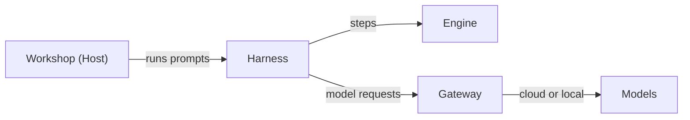

# Workshop Vision

## Vision

Workshop is the open-source IDE our whole team uses every day, in place of the ones we use now. It looks and works like VS Code and Cursor, so nobody has to relearn anything. Underneath, it runs on Runvil, so every agent in it is a prompt you can read, change, and share.

It is two things at once: the editor you already know, and an agent environment you control.

## Why build our own

- **See everything the agent does.** The loop that drives an agent should be visible and editable, not a black box.
- **Work the way we want.** A programmable harness lets the team decide how agents behave, instead of adapting to how a vendor thinks we should work.
- **Keys stay in one place.** Model credentials live in the Gateway. No other process, and nothing on the page, ever sees a vendor key.
- **Every run leaves a record.** Workshop writes each run to a local log that only grows.
- **No one owns the tool we live in.** It is open source, so the team can fix it, extend it, and trust it.

## Familiar by design

We copy the experience of VS Code and Cursor: the look, the layout, the wording, and the behavior. When we are unsure how something should work, we check how Cursor does it and match it. Commands follow VS Code's command ids, and the icons are codicons. We copy the experience and leave the source code alone.

The point is that muscle memory transfers. You open a folder, press the same keys, and use the command palette the same way. The difference shows up in the chat panel.

## Agents are prompts

Every agent in Workshop is a Runvil prompt, which means a Markdown file with prose and Lua side by side. The built-in chat agent is one. Any prompt you put in your agents folder shows up next to it, and a file named `chat.md` replaces the built-in chat agent. Agents can search and read the web, ask you questions, and use the MCP servers you configure.

Because an agent is just a file, you can open it and see how the loop works, change how it compacts a long conversation, or write a new one for your own job and share it with the team.

## How it fits together

Workshop is a Host. It runs every prompt through the Harness, which steps the Engine and performs each request the run makes, including model calls, which go through the Gateway. Workshop and Runvil are separate products, and Workshop is one application built on Runvil.

## Open source

Workshop is open source under the Boost Software License 1.0 and lives in the same repository as Runvil. Installers are published as a nightly prerelease for Windows, macOS (Apple Silicon and Intel), and Linux (AppImage and `.deb`, on x86_64 and ARM64). Every installer includes the Gateway, which stays in the system tray after you close the window so your loaded models stay loaded. Nightly builds do not update themselves, so install a newer one to upgrade.

## Where we are today

- **Editor:** a CodeMirror 6 editor with highlighting for JavaScript, TypeScript, Python, Rust, JSON, Markdown, YAML, and TOML, plus find, multiple cursors, and Go to Line.
- **Workbench:** a file explorer for the folders you open, a command palette, quick open, keybindings, a full menu bar, and settings.
- **Chat panel:** chat tabs with a streaming transcript, tool cards, a model picker, @-mentions, and voice dictation through the Gateway.
- **Agents:** the built-in chat agent, your own agents folder, MCP servers, web search, and questions to the user.
- **Workspaces and logs:** saved workspaces that remember your layout, and the append-only run log.

## The road to replacing our current IDEs

Several pieces we rely on in other IDEs are not built yet. These are the gaps between where Workshop is and where we can switch fully.

- **Everyday editing:** a terminal, a debugger, source control, search across files, symbol navigation, and color themes. These appear in the menus as disabled entries.
- **Extensions:** an extension story, or a clear decision about not having one.
- **Agent capabilities:** file-writing tools, which are still stubs, and local MCP servers.
- **Run history:** a way to read the run log back inside Workshop, and a working Run button.
- **Polish:** chat history, checkpoints and approvals, explorer file operations, and signed installers.
- **Documentation:** the Workshop guide is a "Coming Soon" page.

Each gap is a chance for someone on the team to build a piece of the tool they will use every day.
